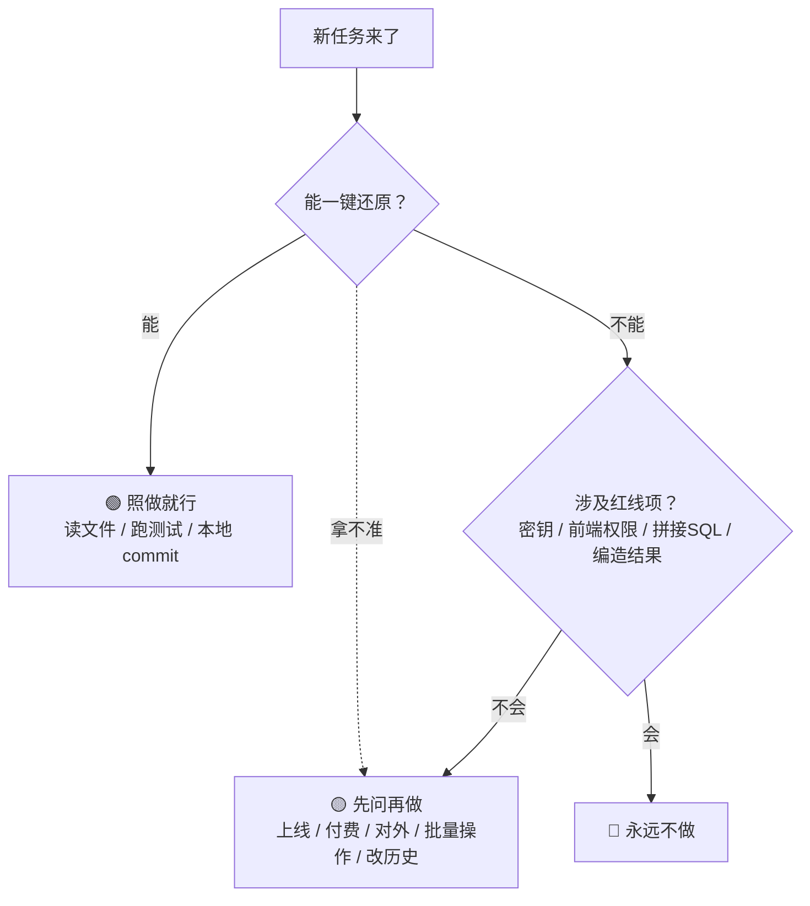

<p align="center">
  
</p>

<h1 align="center">SPN · 零基础 × AI 协作规则</h1>

<p align="center">
  一套写给「不懂代码、但用 AI 做项目」的人的协作规则与安全基线。<br/>
  在 AI 给出的众多选项里，让你的判断沉淀、成形。
</p>

<p align="center">
  <a href="https://xiaoyu-hue.github.io/SPN/"></a>
  <a href="https://github.com/xiaoyu-hue/SPN/stargazers"></a>
  <a href="./LICENSE-DOCS.md"></a>
  <a href="./LICENSE"></a>
  <a href="./docs/README.md"></a>
  
  <br/>
  <a href="https://github.com/xiaoyu-hue/SPN/actions/workflows/doc-lint.yml"></a>
  <a href="https://github.com/xiaoyu-hue/SPN/actions/workflows/doc-quality.yml"></a>
  <a href="https://github.com/xiaoyu-hue/SPN/actions/workflows/secret-scan.yml"></a>
</p>

<p align="center">
  <a href="./docs/README.md">English</a> · 简体中文
</p>

<p align="center">
  <a href="https://xiaoyu-hue.github.io/SPN/"></a>
</p>

> **Self-precipitation（自我析出）**：在 AI 给出的众多选项里，让属于你自己的判断沉淀、成形。
> 核心信条：**代码是 AI 写的，判断是你做的。**

---

## 目录

- [一句话认识 SPN](#一句话认识-spn)
- [为什么需要 SPN（你可能在怕什么）](#为什么需要-spn你可能在怕什么)
- [核心特性](#核心特性)
- [官网预览](#官网预览)
- [快速开始](#快速开始)
  - [给使用者：三步上手](#给使用者三步上手)
  - [给开发者：本地预览与 CI](#给开发者本地预览与-ci)
- [核心规则速览](#核心规则速览)
  - [三档授权（判据：撤销成本由谁承担）](#三档授权判据撤销成本由谁承担)
  - [三档授权速查流程图](#三档授权速查流程图)
  - [零基础用户的三个关键动作](#零基础用户的三个关键动作)
  - [标准工作流（五次握手）](#标准工作流五次握手)
  - [重要决策：三视角分析](#重要决策三视角分析)
- [文档导航（按角色查阅）](#文档导航按角色查阅)
- [技能包（按场景取用）](#技能包按场景取用)
- [仓库结构](#仓库结构)
- [与常见 AGENTS.md 模板的区别](#与常见-agentsmd-模板的区别)
- [规则从何而来](#规则从何而来)
- [工作流规范](#工作流规范)
- [已知局限](#已知局限)
- [贡献](#贡献)
- [许可证](#许可证)
- [致敬与致谢](#致敬与致谢)

---

## 一句话认识 SPN

SPN（Self-precipitation，自我析出）是一套面向**零编程基础用户**的 AI 协作规则：在 AI 给出的众多选项里，让属于你自己的判断沉淀、成形。

AI 编程工具的默认行为是优化"演示能跑"。对懂代码的人是效率提升，对不懂代码的人是风险——你无法判断它写的是否正确、是否偷偷扩大了改动范围。而**安全边界是唯一不产生可见结果的部分**：数据库表锁着还是敞着，页面长得一模一样。

这套规则把**判断权留在人手里**，同时不要求人懂代码。它不追求覆盖所有情况，而是让每条规则对应一类真实发生的问题。

## 为什么需要 SPN（你可能在怕什么）

| 你可能在怕 | 会发生什么 | SPN 怎么兜住 |
|---|---|---|
| **怕 AI 乱改** | 你无法判断它写的是否正确、是否偷偷扩大了改动范围。安全边界是唯一不产生可见结果的部分 | 三档授权把"能不能一键还原"作为唯一判据，拿不准默认先问 |
| **怕泄露密钥** | "测试一下就行"的一句话，可能把密钥、证书、令牌送进前端或仓库，而你毫无察觉 | "永远不做"里明写：密钥进仓库/进前端一律禁止，权限不能只做在前端 |
| **怕"说完成"没完成** | AI 一句"已修复、测试通过"，比明确说"没验证"危害更大——你信了，上线才发现问题 | 要求贴出命令与输出，把"完成"定义为"可验证"，而非"AI 说完成" |

> 如果你本身就是专业开发者，本规则的部分内容（如术语翻译、先试再问）可能显得冗余，请遵循你所在团队的规范。

## 核心特性

- **判断权留在人手里** —— 三档授权（照做 / 先问 / 永远不做），判据只有一个：撤销成本由谁承担。
- **零基础友好** —— "术语必须先翻译才能判断""先试再问"，听不懂的词不当成拍板依据。
- **安全红线内置** —— 提交密钥、权限只做在前端、拼接 SQL、编造测试结果等，列进"永远不做"。
- **重要决策三视角** —— 要求 AI 从"全力反驳 → 切换支持 → 中立对比"分析，而不是只给一个结论。
- **坏 AI vs 好 AI 实时对照** —— [官网预览](#官网预览)把抽象规则变成看得见的场景。
- **按场景取用的技能包** —— 不必常驻全部规则，遇到具体场景才加载对应正文。
- **自查脚本 + CI** —— 链接/数字/事实/技能包规范自动校验，改动有人盯着。

## 官网预览

SPN 配套一个**玻璃质感的介绍官网**，把规则变成看得见的体验：

- 🔗 **[https://xiaoyu-hue.github.io/SPN/](https://xiaoyu-hue.github.io/SPN/)**
- 含「坏 AI vs 好 AI」交互演示、三档授权可视化、移动端适配
- 文案集中在一个文件，GitHub Pages 推送即自动部署

如果你是第一次接触 SPN，建议**先去官网 30 秒看懂它是什么**，再回来看下面的规则细节。

## 快速开始

### 给使用者：三步上手

1. **复制 `AGENTS.md`** 到你的项目根目录。支持 AGENTS.md 的工具（Cursor、Codex、Copilot、Gemini CLI、Aider、Windsurf 等）会在开工前自动加载它。
2. **按需查阅 `references/`**：遇到具体问题（要上线、写 README、不知道怎么表达需求）时，翻对应的篇章。
3. **上线 / 做不可逆决定前**，先过一遍 `references/07-决策审查清单.md`，把"坏处 / 不做的后果 / 什么情况下会后悔"想清楚再动手。

> 如果你只需要某一块能力（例如只想要"上线前安全自查"），不必装整份规则——直接用 `templates/skills/` 下的场景技能包，见下文「[技能包（按场景取用）](#技能包按场景取用)」。

> 关于加载：`Claude Code` 在存在自身配置文件时默认不读取 AGENTS.md，需要导入或单独开启。稳妥做法是以 AGENTS.md 作为共享基线，再为个别工具补一个薄薄的专属文件（例如在 `CLAUDE.md` 中写 `@AGENTS.md`）。

### 给开发者：本地预览与 CI

- 克隆仓库后，`skills/spn/` 是一个自包含、可安装的技能包，详见 [`skills/spn/INSTALL.md`](./skills/spn/INSTALL.md)。
- 本仓库的文档与质量保障已落地为 CI：密钥扫描 **gitleaks**、死链检查 **lychee**、术语一致 **vale**、数字写死检查 **doc-lint**（详见 `.github/workflows/`）。
- 想修改规则：请回到**根目录**（规范源）编辑，再由发布流程同步到 `docs/`（英文镜像）与 `skills/spn/`、`skills/spn-en/`（发布包）。
- 想引入本规则到自己的 Agent：直接加载 `skills/spn/`，或把根目录 `AGENTS.md` 拷进项目。
- **想发版**：先在 `CHANGELOG.md` 的 `[Unreleased]` 写下改动，再执行 `python3 scripts/release.py <版本号>`（预览 diff），确认无误后加 `--yes`。脚本会自动同步徽章、版本号、技能包正文与快照，跑完校验再打 tag、建 Release。
- **改动了 `AGENTS.md` / `SKILL.md`**：跑 `python3 scripts/sync_snapshots.py --apply` 同步到两个技能包（`--check` 只校验，CI 每次提交都跑）。
- **想自查**：`python3 scripts/check_links.py`（相对链接与锚点）、`python3 scripts/doc_lint.py`（有没有写死、会失真的数字）、`python3 scripts/check_facts.py`（`FACTS.md` 里有没有该复核的事实）、`python3 scripts/run_tests.py`（脚本自身的单元测试）、`python3 scripts/validate_skills.py`（技能包是否符合规范）。

## 核心规则速览

### 三档授权（判据：撤销成本由谁承担）

- **允许（照做就行）** —— 读取文件、运行测试、本地可逆改动（含本地 `commit`，有 reflog 可还原）
- **需先确认（先问再做）** —— 修改数据库结构、上线发布、对外动作、批量操作、`push` 及任何改写已推送历史的操作
- **禁止（永远不做）** —— 提交密钥、密钥进入前端、权限只做在前端、拼接 SQL、静默兜底、编造测试结果

### 三档授权速查流程图

> 拿到一个任务，先沿下面这张图走一遍：能不能一键还原？涉及红线项吗？**拿不准就默认「先问」**。



### 零基础用户的三个关键动作

1. **术语必须先翻译，才能判断** —— 不要用听不懂的词拍板。听不懂不是你的问题，是对方没讲清楚。
2. **先试再问** —— 判据只有一条：能不能一键还原？能就试，不能就问。
3. **能力不等于担保** —— AI 能写出加密代码，但"未经审计"这句声明得由你来写。

### 标准工作流（五次握手）

说清目标 → AI 复述验收标准 → 给出方案并说明权衡 → 拆小步逐段交付 → 人验证且 AI 如实说明

### 重要决策：三视角分析

涉及方案选型、是否上线等重要决定时，要求 AI 从"全力反驳 → 切换支持 → 中立对比"三个视角分析，而不是只给一个结论。

配套的**调试三步法**：描述报错 → 用通俗语言解释原因 → 给出修复步骤，禁止没有定位根因就直接重写。

## 文档导航（按角色查阅）

| 你想做什么 | 看这里（根目录，简体中文） |
|---|---|
| 理解判断归属、"先试再问"的判据 | `references/01-协作哲学与判断归属.md` |
| 准备上线 | `references/02-上线前安全自查.md` |
| 写 README、选许可证、避免数字写死 | `references/03-文档、局限披露与事实维护.md` |
| 不知道怎么跟 AI 表达需求 | `references/04-提示词库.md` |
| 看真实场景的"好/坏协作"对照 | `references/05-协作示例画廊.md` |
| 想了解同类项目 / 优秀 skill / 插件怎么整合 | `references/06-生态与整合.md` |
| 做不可逆/花钱/发布决定前必过的审查 | `references/07-决策审查清单.md` |
| 代码或文档变动后保持描述与事实一致 | `references/08-文档同步规范.md` |
| 想要按场景取用的小技能包 / 学习怎么写 SKILL.md | `templates/`（见 [`templates/README.md`](./templates/README.md)） |

> 以上所有文件及 `AGENTS.md` / `SKILL.md` / `SECURITY.md` / `CONTRIBUTING.md` 的**英文完整版**均可在 [`docs/`](./docs/) 找到。

## 技能包（按场景取用）

> 整份 `AGENTS.md` 是常驻基线（每次开工都加载）；而 `templates/skills/` 下的技能包是**按需触发**的——遇到具体场景时，Agent 才把对应正文读进来。好处：不必把全部规则常驻在上下文，也更容易分享给只需要某一块的人。

### 五个场景技能包

| 技能包 | 解决什么场景 | 触发信号 / 何时用 | 源自 SPN |
|---|---|---|---|
| `spn-security-check` | 上线前扮演攻击者自查：未授权读取、越权访问、密钥泄漏、UUID 与递增 ID、无限流 | 准备上线、部署到公网、"我这个应用安全吗""会不会泄露数据" | `references/02` |
| `spn-decision-review` | 不可逆 / 花钱 / 发布前的决策三问 + 替代方案 + 拍板记录 | 技术选型、是否上线、要不要引入依赖、能否删掉旧功能 | `references/07` |
| `spn-handoff` | 跨会话记忆：一个 `HANDOFF.md` 解决"会话失忆" | "这个会话要结束了""下次怎么接着做""先读交接文档" | `references/04` |
| `spn-term-translator` | 把术语翻译成大白话，保护"人无法为听不懂的东西负责" | "这个词是什么意思""用大白话讲一遍" | `references/04` |
| `spn-docs-sync` | 发版前的最后一轮文档校对：唯一真源原则 | 刚改完功能 / 准备发版 / "文档说的和实际不一样" | `references/08` |

每个包的正文都遵循 SPN 自身的原则：不吹能力（都写清"覆盖不了什么"）、不替人做决定、说实话优先、涉及安全的声明由人自己写。完整清单与 `_skeleton` 空白骨架见 [`templates/README.md`](./templates/README.md)。

### 怎么用（使用引导）

**方式一：作为 Agent Skills 安装**（推荐，约 1 分钟）

把需要的包整个目录拷进 Agent 的技能目录即可。以 CodeBuddy 为例：

```bash
cp -r templates/skills/spn-security-check ~/.codebuddy/skills/spn-security-check
```

其它工具的路径通常是 `~/.<工具名>/skills/` 或项目内 `.<工具名>/skills/`（如 Claude Code 用 `~/.claude/skills/`），以该工具文档为准。

**方式二：不装任何东西（最小用法）**

直接把某个 `SKILL.md` 的正文（去掉开头 `---` 之间的元数据）整段贴给 AI，效果一样。适合只临时用一次、或想先看看它怎么写。

**验证是否生效**：新开会话，说出对应触发信号（例如"准备上线，帮我按 SPN 自查安全问题"）。若 AI 开始扮演攻击者逐项排查，并区分"没找到问题"与"没有问题"——说明技能已加载。

> 想自己写一个场景技能包？复制 `templates/skills/_skeleton/` 起步，写法与 `description` 触发句式见 [`templates/README.md`](./templates/README.md)。

## 仓库结构

SPN 采用**通用层 + 个人层**两层结构，并配有英文镜像与可直接加载的技能包。

> **约定（防止改错地方）**：**根目录是唯一规范源**（可修改的真相）；`docs/` 是英文镜像、`skills/spn/` 与 `skills/spn-en/` 是可安装发布包——这两者都是根目录的**发布副本**，修改规则请回到根目录，再由发布流程同步。

```
SPN/
├── README.md              ← 本文件（简体中文，规范源）
├── AGENTS.md              ← 通用规则，所有人均可使用（AI 实际加载执行）
├── SKILL.md               ← 技能入口与完整说明（规范源）
├── references/            ← 通用规则详解（共 8 篇，规范源）
│   ├── 01-协作哲学与判断归属.md
│   ├── 02-上线前安全自查.md
│   ├── 03-文档、局限披露与事实维护.md
│   ├── 04-提示词库.md
│   ├── 05-协作示例画廊.md
│   ├── 06-生态与整合.md
│   ├── 07-决策审查清单.md        ← 工作流规范：决策前反问
│   └── 08-文档同步规范.md        ← 工作流规范：发布前同步
├── docs/                  ← 英文完整镜像（README + AGENTS + SKILL + references）★发布副本
├── skills/
│   ├── spn/               ← 可安装技能包（中文，含 INSTALL.md）★发布副本
│   └── spn-en/            ← 可安装技能包（英文）★发布副本
├── scripts/               ← 发布与校验脚本（见下表）
├── FACTS.md               ← 带时效的事实登记表（给 CI 读）
├── templates/             ← 按场景切分的可安装技能包模板 + 写法说明
├── personal/              ← 作者自用层，可跳过（非通用规则，已脱敏）
├── website/               ← 配套介绍官网（Vite + React + 液态玻璃，GitHub Pages 自动部署）
└── LICENSE-DOCS.md        ← 文档 CC BY 4.0 许可
```

### `scripts/` 里都有什么

| 脚本 | 干什么 | 什么时候跑 |
|---|---|---|
| `release.py` | 一键发版（默认 dry-run，`--yes` 才写盘推送） | 发版时 |
| `sync_snapshots.py` | 规范源 → 发布副本，含一致性校验 | 每次提交（CI）+ 发版时 |
| `doc_lint.py` | 抓入口文件里写死、会失真的数字 | 每次提交（CI） |
| `check_facts.py` | 提醒 `FACTS.md` 里已登记的事实过期 | 每次提交（CI，非阻塞） |
| `check_links.py` | 全仓库相对链接与锚点自检 | 每次提交 + 发版时 |
| `run_tests.py` | 脚本自身的单元测试 | 每次提交（CI，三系统） |
| `validate_skills.py` | 校验技能包是否符合 Agent Skills 规范 | 每次提交（CI） |

- 只想使用规则：只看根目录，忽略 `personal/`。
- 想看英文版：全部内容已镜像到 `docs/`。
- 想把规则直接加载进 AI Agent：用 `skills/spn/`，详见 [`skills/spn/INSTALL.md`](./skills/spn/INSTALL.md)。
- 需要英文技能包：用 `skills/spn-en/`，详见 [`skills/spn-en/INSTALL.md`](./skills/spn-en/INSTALL.md)。
- 想复制一份自己的：复制 `personal/` 改成你的内容，`AGENTS.md` 继承根目录通用规则，只叠加你自己的上下文。详见 `personal/README.md`。

## 与常见 AGENTS.md 模板的区别

| 常见模板 | 这套规则 |
|---|---|
| 写"用什么命令、什么代码风格" | 写"谁做决定、什么时候必须停" |
| 假设使用者懂技术 | **假设使用者完全不懂技术** |
| 只写能做什么 | 一半篇幅写**不能做什么、做不到什么** |
| 直接给结论 | 要求 AI 讲清取舍，由人拍板 |
| 通用最佳实践 | 每条对应一类真实发生的问题 |

## 规则从何而来

这不是模板。每条规则背后都是一个真实发生的问题，来自一个零基础用户借助 AI 完成多个上线项目的过程：

| 真实发生的问题 | AI 做了什么 | 人做了什么 |
|---|---|---|
| 第一次把项目弄上线 | 推荐了多个静态部署平台 | 它给的是候选清单，不是命令；平台由人选定 |
| 两种视觉风格能否融合 | 表示无法保证能融合 | 想要就直接试——试出来后成了整个项目的视觉基调 |
| 给加密应用划定安全边界 | 顺利写出了密钥协商、签名代码 | 但"未经审计""不建议用于敏感场景"的声明，由人自己写进 README |

共同点：**AI 提供能力与方案，人负责拍板与划边界。**

完整叙事与"先试再问 vs 先问再试"的判据，见 `references/01-协作哲学与判断归属.md`。

## 工作流规范

两份可直接套用到任意项目的通用工作流规范（内含可填写的清单与记录模板）：

- **`references/07-决策审查清单.md`** —— 做决定之前的反问工具：决策三问（坏处 / 不做的后果 / 后悔条件）+ 五层追问 + 反悔场景速查 + 拍板记录模板。与「做完之后写记录」的 ADR / CHANGELOG 互补。
- **`references/08-文档同步规范.md`** —— 代码 / CI / 功能变化后，让「文档描述」与「代码事实」保持一致的「唯一真源原则」+ 同步清单 + SemVer 判定 + 发布前验证 + 同步检查模板。

> 英文版见 [`docs/references/07-decision-review.md`](./docs/references/07-decision-review.md) 与 [`docs/references/08-doc-sync.md`](./docs/references/08-doc-sync.md)。

## 已知局限

- 本规则针对"人不懂代码"的场景优化。专业开发者使用会嫌冗余，应遵循各自团队规范。
- `references/02-上线前安全自查.md` 中的 SQL 与命令以 Supabase / Postgres 为例，Firebase、Cloudflare D1 等其他后端需自行调整。
- 深度参考 `references/02-上线前安全自查.md` 中引用的安全事件与平台免费额度核实于 2026 年 10 月，会随时间变化，使用前请复核。
- **本规则不能替代专业安全审计。** 涉及他人真实敏感数据（医疗、金融、身份信息）的应用，仍建议寻求专业审查。
- 参考资料 `01`–`08` 及 `AGENTS.md` / `SKILL.md` / `SECURITY.md` / `CONTRIBUTING.md` 均已提供英文版，见 `docs/`；`personal/` 仍仅中文。

## 贡献

欢迎提交 issue 与 pull request。

- Bug 与想法：写清"你做了什么、期望什么、实际发生了什么"。
- 结构性改动（架构、依赖、安全相关）请先开 issue 对齐方向。
- 中英文均可，英文写得简单也没关系。
- 通用规则与作者自用规则的分界、如何新增一条规则，见 `CONTRIBUTING.md`。

## 许可证

本仓库采用**代码与文档分离的分层许可证**：

| 内容 | 许可证 | 文件 |
|---|---|---|
| **代码**（脚本、CI 配置、可执行工具） | **MIT** | `LICENSE` |
| **文档**（全部规则、提示词、参考资料） | **CC BY 4.0**（署名） | `LICENSE-DOCS.md` |

在署名的前提下，你可以自由使用、转载、修改本仓库文档，并可用于商业或非商业用途；代码依据 MIT 许可证使用。完整条款见对应许可证文件。

> 说明：`LICENSE`（MIT）会被 GitHub 自动识别并在仓库侧栏显示徽章；文档采用的 CC BY 4.0 以 `LICENSE-DOCS.md` 为准（GitHub 侧栏仅自动识别 CC0-1.0，不识别 CC BY 4.0）。

## 致敬与致谢

SPN 站在许多开源规范、工具与社区的肩膀上。以下内容为本仓库**直接引用、对齐或受其启发**，均按其各自许可证使用，且**未复制其源代码**（遵循 `references/06` 的"引用不复制"原则）：

- **Anthropic Agent Skills** — `skills/spn/` 与 `skills/spn-en/` 的 `SKILL.md` 采用其官方 Agent Skills 规范（frontmatter + 描述式触发）。规范见 [`anthropics/skills`](https://github.com/anthropics/skills)。
- **知识共享（Creative Commons）** — 全部文档采用 **CC BY 4.0**（署名 4.0 国际）许可，许可文本由 CC 官方发布。
- **Keep a Changelog / Semantic Versioning** — `CHANGELOG.md` 与版本号遵循其约定。
- **策展式生态索引（`references/06`）** — 其中列出的同类项目、技能集合、安全与文档工具、插件与 MCP，均为本仓库调研与延伸阅读的源头，详见该文。
- **CI 工具链** — 密钥扫描 [`gitleaks`](https://github.com/gitleaks/gitleaks)、死链检查 [`lychee`](https://github.com/lycheeverse/lychee)、术语检查 [`vale`](https://github.com/errata-ai/vale) 为本仓库的质量保障提供支撑。

> 本仓库自身的规则内容（含 `references/07`、`08` 两份工作流规范）为作者原创，以 CC BY 4.0 共享；如使用了你的成果，欢迎在 issue 中告知以便补正署名。

---

**版本** [`v1.1.0`](https://github.com/xiaoyu-hue/SPN/releases/tag/v1.1.0) · **更新日志** [`CHANGELOG.md`](./CHANGELOG.md) · **许可证** [`CC BY 4.0`](./LICENSE-DOCS.md) / [`MIT`](./LICENSE) · **官网** [`在线预览 →`](https://xiaoyu-hue.github.io/SPN/)
