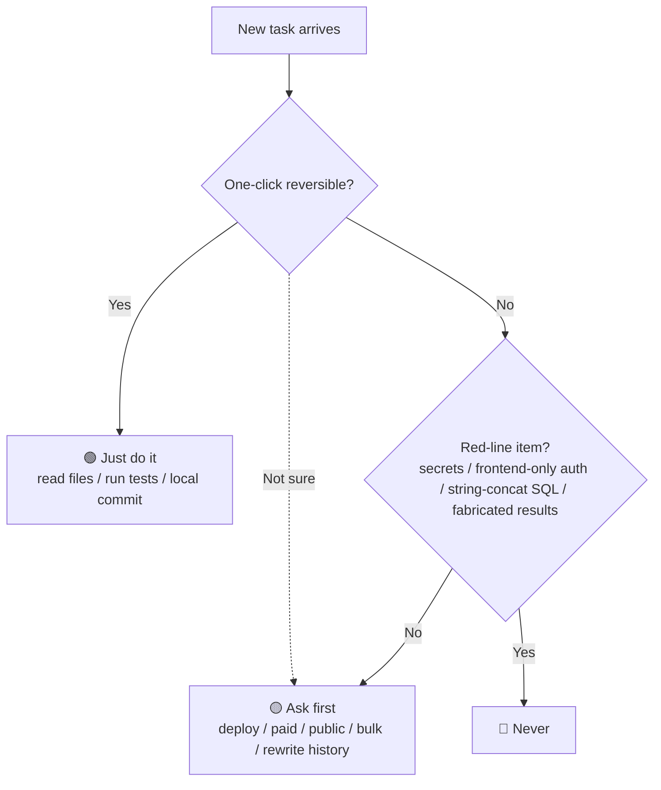

<p align="center">
  
</p>

<h1 align="center">SPN · AI Collaboration Rules for Non-Coders</h1>

<p align="center">
  A set of collaboration rules and a safety baseline for people who "can't code but build with AI."<br/>
  Let your judgment precipitate and take shape amid the many options the AI hands you.
</p>

<p align="center">
  <a href="https://xiaoyu-hue.github.io/SPN/"></a>
  <a href="https://github.com/xiaoyu-hue/SPN/stargazers"></a>
  <a href="../LICENSE-DOCS.md"></a>
  <a href="../LICENSE"></a>
  <a href="./README.md"></a>
  
  <br/>
  <a href="https://github.com/xiaoyu-hue/SPN/actions/workflows/doc-lint.yml"></a>
  <a href="https://github.com/xiaoyu-hue/SPN/actions/workflows/doc-quality.yml"></a>
  <a href="https://github.com/xiaoyu-hue/SPN/actions/workflows/secret-scan.yml"></a>
</p>

<p align="center">
  <a href="../README.md">简体中文</a> · English
</p>

<p align="center">
  <a href="https://xiaoyu-hue.github.io/SPN/"></a>
</p>

> **Self-precipitation**: amid the many options the AI hands you, let your own judgment precipitate and take shape.
> The whole idea fits in one line: **the AI writes the code; you make the calls.**

---

## Table of contents

- [What this is](#what-this-is)
- [Why you need SPN (what you might be afraid of)](#why-you-need-spn-what-you-might-be-afraid-of)
- [Core features](#core-features)
- [Website preview](#website-preview)
- [Website tech stack & architecture](#website-tech-stack-architecture)
- [Quick start](#quick-start)
  - [For users: three steps](#for-users-three-steps)
  - [For developers: local preview and CI](#for-developers-local-preview-and-ci)
- [Core rules at a glance](#core-rules-at-a-glance)
  - [Three authorization tiers (test: who pays the cost of undoing it)](#three-authorization-tiers-test-who-pays-the-cost-of-undoing-it)
  - [Three-tier authorization quick-flow chart](#three-tier-authorization-quick-flow-chart)
  - [Three key moves for non-coders](#three-key-moves-for-non-coders)
  - [Standard workflow (the five-step handshake)](#standard-workflow-the-five-step-handshake)
  - [Important decisions: three-perspective analysis](#important-decisions-three-perspective-analysis)
- [Documentation navigation (by role)](#documentation-navigation-by-role)
- [Skill packages (use by scenario)](#skill-packages-use-by-scenario)
- [Repository structure](#repository-structure)
- [How this differs from typical AGENTS.md templates](#how-this-differs-from-typical-agentsmd-templates)
- [Where the rules come from](#where-the-rules-come-from)
- [Workflow standards](#workflow-standards)
- [Known limitations](#known-limitations)
- [Contributing](#contributing)
- [License](#license)
- [Acknowledgments](#acknowledgments)

---

## What this is

SPN (Self-precipitation) is a set of AI collaboration rules for people with **zero programming background**: amid the many options the AI hands you, let your own judgment precipitate and take shape.

The default behavior of AI coding tools is to optimize for "the demo runs." For someone who can read code that's a productivity win; for someone who can't, it's a risk — you can't tell whether what it wrote is correct, or whether it quietly expanded the scope of changes. And **security boundaries are the one part that produces no visible result**: a database table that's locked and one that's wide open render an identical page.

These rules keep **the judgment with the human**, without requiring the human to understand code. They don't try to cover everything; instead, each rule maps to a class of real failure.

## Why you need SPN (what you might be afraid of)

| What you might fear | What actually happens | How SPN catches it |
|---|---|---|
| **Afraid the AI changes things recklessly** | You can't tell whether it's correct, or whether it quietly expanded the scope. Security boundaries are the only part that produces no visible result. | The three authorization tiers use "can it be undone with one click" as the only test; when in doubt, ask first by default. |
| **Afraid of leaking secrets** | A casual "just test it" can drop a key, cert, or token into the frontend or the repo, and you'd never notice. | "Never" lists it explicitly: secrets in the repo or the frontend are forbidden; authorization can't live only in the frontend. |
| **Afraid "done" doesn't mean done** | An AI saying "fixed, tests pass" is more dangerous than saying "unverified" — you trust it, and find out at launch. | It must paste the command and its output; "done" means "verifiable," not "the AI says so." |

> If you're a professional developer, some of this (translating jargon, try-before-ask) may feel redundant — follow your team's own conventions.

## Core features

- **Judgment stays with the human** — three authorization tiers (just do it / ask first / never), with one test only: who pays the cost of undoing it.
- **Friendly to non-coders** — "translate the jargon before you decide," "try before you ask"; words you don't understand are never the basis for a decision.
- **Safety red lines built in** — committing secrets, frontend-only authorization, string-concatenated SQL, fabricated test results, all listed under "never."
- **Three-perspective analysis for important calls** — the AI must argue from "full rebuttal → switch to support → neutral comparison," not just hand you one conclusion.
- **Bad AI vs. good AI, side by side** — the [website preview](#website-preview) turns abstract rules into scenes you can see.
- **Skill packages by scenario** — you don't keep every rule loaded; the matching body is pulled in only when a scenario appears.
- **Self-check scripts + CI** — links / numbers / facts / skill-package rules are auto-checked, so changes are watched.

## Website preview

SPN ships a **glass-textured intro website** that turns the rules into a visible experience:

- 🔗 **[https://xiaoyu-hue.github.io/SPN/](https://xiaoyu-hue.github.io/SPN/)**
- Includes a "bad AI vs. good AI" interactive demo, a visualization of the three authorization tiers, and mobile adaptation
- All copy lives in one file; pushing to GitHub Pages deploys automatically

If this is your first contact with SPN, **spend 30 seconds on the website to get what it is**, then come back for the rule details.

## Website tech stack & architecture

SPN's website is a **hand-written liquid-glass static site**: no backend, no database, auto-deployed to GitHub Pages.

**Tech stack**


**Architecture highlights**

- **Build**: Vite + React 18 + TypeScript, a pure static single-page app (SPA), no server-side dependency.
- **Glass aesthetic**: hand-written layered CSS (`.glass` tint + blur + highlight edge + refraction), no off-the-shelf glass library — deliberately avoiding the generic "AI look."
- **Centralized content**: all site copy lives in `src/content.ts`, so you change words not code, avoiding copy drift across iterations.
- **Deployment**: pushing to `main` triggers `.github/workflows/deploy.yml` to build and publish to GitHub Pages.
- **Mobile**: bottom navigation + 44px touch targets + safe-area adaptation, matching big-tech mobile conventions.

Source in [`website/`](../website/); live preview in [Website preview](#website-preview).

## Quick start

### For users: three steps

1. **Copy `AGENTS.md`** into your project directory. Tools that support AGENTS.md (Cursor, Codex, Copilot, Gemini CLI, Aider, Windsurf, and others) load it automatically before work begins.
2. **Look up `references/` as needed**: when a concrete question arises (about to ship, writing a README, not sure how to phrase a request), open the matching doc.
3. **Before shipping or any irreversible decision**, run through [`references/07-decision-review.md`](references/07-decision-review.md) — think through downside / cost of not doing it / when you'd regret it before acting.

> If you only need one slice of capability (say, just "pre-launch security self-check"), you don't have to install the whole rule set — use the scenario skill packages under `templates/skills/`, see [Skill packages](#skill-packages-use-by-scenario) below.

> On loading: `Claude Code` doesn't read AGENTS.md by default when its own config file exists — you need to import it. A safe pattern is to use AGENTS.md as the shared baseline, then add a thin tool-specific file (e.g. put `@AGENTS.md` inside `CLAUDE.md`).

### For developers: local preview and CI

- After cloning, `skills/spn-en/` is the self-contained, installable skill package for English — see [`skills/spn-en/INSTALL.md`](../skills/spn-en/INSTALL.md).
- Documentation and quality gates are enforced in CI: secret scan **gitleaks**, dead-link check **lychee**, terminology **vale**, and hardcoded-number check **doc-lint** (see `.github/workflows/`).
- To change the rules: edit the **root directory** (the source of truth), then let the publish flow sync to `docs/` (English mirror) and `skills/spn/` + `skills/spn-en/` (packages).
- To bring the rules into your own Agent: load `skills/spn-en/`, or copy the root `AGENTS.md` into your project.
- **To cut a release**: log the change under `[Unreleased]` in `CHANGELOG.md`, then run `python3 scripts/release.py <version>` to preview the diff; add `--yes` once it looks right. The script syncs the badges, version strings, and package bodies, runs the checks, then tags and creates the Release.
- **Changed `AGENTS.md` / `SKILL.md`?** Run `python3 scripts/sync_snapshots.py --apply` to push it into both skill packages (`--check` verifies only; CI runs that on every push).
- **Self-checks**: `python3 scripts/check_links.py` (relative links and anchors), `python3 scripts/doc_lint.py` (hardcoded numbers that will drift), `python3 scripts/check_facts.py` (facts due for re-verification), `python3 scripts/run_tests.py` (unit tests for the scripts themselves), `python3 scripts/validate_skills.py` (skill packages vs. the Agent Skills spec).

## Core rules at a glance

### Three authorization tiers (test: who pays the cost of undoing it)

- **Allowed (just do it)** — reading files, running tests, locally reversible changes (including a local `git commit`, recoverable via reflog)
- **Ask first** — changing database schema, deploying, publishing, outward-facing actions, bulk operations, and Git operations that affect others: push, force-push, rebase, reset --hard, branches, tags
- **Never** — committing secrets, putting service-role keys in frontend code, doing authorization only in the frontend, string-concatenating SQL, silently swallowing errors, fabricating test results

### Three-tier authorization quick-flow chart

> Got a task? Walk it through this chart first: can it be undone with one click? Does it hit a red line? **When in doubt, default to "ask first."**



### Three key moves for non-coders

1. **Translate before you decide.** Never approve something using words you don't understand. Not understanding is not your fault — it failed to explain.
2. **Try first or ask first?** One test: can it be undone with one click? If yes, try it. If no, ask.
3. **Capability is not a guarantee.** The AI can write crypto code. The phrase "not professionally audited" is yours to write, not its.

### Standard workflow (the five-step handshake)

State the goal → AI restates the acceptance criteria → AI gives options with tradeoffs → deliver in small verifiable steps → human verifies, and AI states honestly what it did and didn't confirm

### Important decisions: three-perspective analysis

For important calls (architecture, whether to ship, etc.), require the AI to analyze from three perspectives — **full rebuttal → switch to support → neutral comparison** — instead of handing you a single conclusion.

Paired with the **debug three-step rule**: describe the error → explain the cause in plain language → give fix steps; no rewriting blindly before the root cause is found.

## Documentation navigation (by role)

| What you're doing | Read this (English, this folder) |
|---|---|
| Who decides what; the try-vs-ask test | [`references/01-collaboration-philosophy.md`](references/01-collaboration-philosophy.md) |
| About to ship | [`references/02-pre-launch-security-checklist.md`](references/02-pre-launch-security-checklist.md) |
| Writing a README / picking a license / keeping numbers from going stale | [`references/03-documentation-disclosure-maintenance.md`](references/03-documentation-disclosure-maintenance.md) |
| Not sure how to phrase a request | [`references/04-prompt-library.md`](references/04-prompt-library.md) |
| See real good/bad collaboration examples | [`references/05-collaboration-examples.md`](references/05-collaboration-examples.md) |
| Curated external projects / Skills / plugins | [`references/06-ecosystem-and-integrations.md`](references/06-ecosystem-and-integrations.md) |
| Decision review before irreversible / paid / public calls | [`references/07-decision-review.md`](references/07-decision-review.md) |
| Doc-and-code sync after changes | [`references/08-doc-sync.md`](references/08-doc-sync.md) |

> Everything above, plus `AGENTS.md`, `SKILL.md`, `SECURITY.md`, and `CONTRIBUTING.md`, is available in English right here under `docs/`.

## Skill packages (use by scenario)

> The full `AGENTS.md` is an always-on baseline (loaded every session); the packages under `templates/skills/` are **triggered on demand** — the Agent reads the matching body only when a specific scenario appears. Upside: you don't keep every rule in context, and it's easier to share just one slice with someone.

### Five scenario packages

| Package | What it handles | Trigger signals / when to use | From SPN |
|---|---|---|---|
| `spn-security-check` | Pre-launch attacker self-audit: unauthorized reads, privilege escalation, secret leakage, UUID vs sequential IDs, missing rate limits | about to ship, deploy to the public web, "is my app secure" / "will it leak data" | `references/02` |
| `spn-decision-review` | Pre-irreversible / paid / publish decision three-question review + alternatives + sign-off log | choosing a tech, whether to launch, adding a dependency, deleting old features | `references/07` |
| `spn-handoff` | Cross-session memory: a single `HANDOFF.md` fixes "the session has amnesia" | "this session is ending" / "how do I continue next time" / "read the handoff doc" | `references/04` |
| `spn-term-translator` | Translate jargon into plain language; protects "people can't own a decision they don't understand" | "what does this word mean" / "explain it in plain language" | `references/04` |
| `spn-docs-sync` | Final doc proofread before release: single-source-of-truth principle | just changed features / about to release / "docs say something different from reality" | `references/08` |

Each package follows SPN's own principles: no overclaiming (each states what it can't cover), never decides for the human, honesty first, and security statements are written by the human. Full list and the `_skeleton` starter are in [`templates/README.md`](../templates/README.md).

### How to use

**Option 1: Install as an Agent Skill** (recommended, about 1 minute)

Copy the whole package directory into your Agent's skills directory. With CodeBuddy:

```bash
cp -r templates/skills/spn-security-check ~/.codebuddy/skills/spn-security-check
```

Other tools usually use `~/.<tool>/skills/` or project-level `.<tool>/skills/` (e.g. Claude Code uses `~/.claude/skills/`); check the tool's docs.

**Option 2: No install (minimal)**

Just paste a package's `SKILL.md` body (minus the `---` frontmatter) straight into the chat. Same effect. Good for a one-off use or to peek at how it's written.

**Verify it loaded**: open a fresh session and say the trigger (e.g. "I'm about to ship, run SPN's security self-check"). If the AI starts enumerating attacks and distinguishes "found nothing" from "no problem" — the skill is loaded.

> Want to write your own? Copy `templates/skills/_skeleton/` to start; writing guide and the `description` trigger phrasing are in [`templates/README.md`](../templates/README.md).

## Repository structure

SPN uses a **universal layer + personal layer** structure, plus an English edition and a ready-to-load skill package:

> **Convention (so you don't edit the wrong place)**: **the root directory is the only source of truth** (the modifiable truth); `docs/` is the English mirror, and `skills/spn/` + `skills/spn-en/` are installable release packages — both are **release copies** of the root. To change a rule, edit the root, then let the publish flow sync it.

```
SPN/
├── README.md              ← this file's Chinese original (source of truth)
├── AGENTS.md              ← universal rules, for everyone (what the AI actually loads)
├── SKILL.md               ← skill entry point and full documentation (Chinese)
├── references/            ← universal rules in detail (8 docs, Chinese)
│   ├── 01-collaboration-philosophy.md
│   ├── 02-pre-launch-security-checklist.md
│   ├── 03-documentation-disclosure-maintenance.md
│   ├── 04-prompt-library.md
│   ├── 05-collaboration-examples.md
│   ├── 06-ecosystem-and-integrations.md
│   ├── 07-decision-review.md        ← workflow template: pre-decision questions
│   └── 08-doc-sync.md               ← workflow template: pre-release sync
├── docs/                  ← English edition: full mirror (README + AGENTS + SKILL + references) ★ release copy
├── skills/
│   ├── spn/               ← installable skill package (Chinese, with INSTALL.md) ★ release copy
│   └── spn-en/            ← installable skill package (English) ★ release copy
├── scripts/               ← release and verification scripts (see below)
├── FACTS.md               ← time-sensitive facts register (read by CI)
├── templates/             ← per-scenario skill-package templates + how to write them
├── personal/              ← the author's own layer, safe to skip (not universal rules, sanitized)
├── website/               ← companion intro website (Vite + React + liquid glass, GitHub Pages auto-deploy)
└── LICENSE-DOCS.md        ← CC BY 4.0 terms for all documentation
```

### What's in `scripts/`

| Script | What it does | When it runs |
|---|---|---|
| `release.py` | One-command release (dry-run by default; `--yes` actually writes and pushes) | at release time |
| `sync_snapshots.py` | Source → release copies, plus a consistency check | every push (CI) + release |
| `doc_lint.py` | Catches hardcoded numbers that will go stale | every push (CI) |
| `check_facts.py` | Flags registered facts in `FACTS.md` due for re-verification | every push (CI, non-blocking) |
| `check_links.py` | Relative links and anchors across the repo | every push + release |
| `run_tests.py` | Unit tests for the scripts themselves | every push (CI, three OSes) |
| `validate_skills.py` | Validates skill packages against the Agent Skills spec | every push (CI) |

- Only want the rules? Read the root directory and ignore `personal/`.
- Want the English version? Everything is mirrored under `docs/`.
- Want to load the rules into an AI Agent directly? Use `skills/spn-en/` — see [`skills/spn-en/INSTALL.md`](../skills/spn-en/INSTALL.md).
- Want your own copy? Duplicate `personal/`, fill in your context, and let `AGENTS.md` inherit the universal rules — you only add your own layer. See `personal/README.md`.

## How this differs from typical AGENTS.md templates

| Typical template | These rules |
|---|---|
| Lists commands and code style | Defines who decides and when to stop |
| Assumes the reader knows tech | **Assumes the reader knows nothing about tech** |
| Lists what you can do | Half the content is **what you must not do, and what it can't do** |
| Gives a conclusion | Requires the AI to present tradeoffs for a human to decide |
| Generic best practices | Every rule maps to a real failure mode |

## Where the rules come from

This isn't a template. Behind every rule is a real failure, drawn from a non-coder shipping multiple projects with AI:

| What actually happened | What the AI did | What the human did |
|---|---|---|
| Shipping a project for the first time | Recommended several static-hosting platforms | It gave a candidate list, not a command; the human picked the platform |
| Whether two visual styles could merge | Said it couldn't guarantee a merge | The human just tried it — and the result became the project's visual foundation |
| Drawing a security boundary for a crypto app | Wrote key agreement and signing code cleanly | But the "not audited" / "not for sensitive use" disclaimer was written by the human, into the README |

The common thread: **the AI supplies capability and options; the human makes the call and draws the boundary.**

The full narrative and the try-vs-ask test are in [`references/01-collaboration-philosophy.md`](references/01-collaboration-philosophy.md).

## Workflow standards

Two reusable workflow standards you can drop into any project (each ships with fill-in checklists and log templates):

- **`references/07-decision-review.md`** — a pre-decision questioning tool: the three decision questions (downsides / cost of not doing it / regret conditions) + five layers of follow-up + regret-scenario quick reference + a decision-log template. Complements post-decision records like ADR / CHANGELOG.
- **`references/08-doc-sync.md`** — an execution checklist to keep "what the docs say" consistent with "what the code actually does" after code / CI / feature changes: the Single Source of Truth principle + sync checklist + SemVer rules + pre-release verification + a sync-check template.

> Chinese originals: [`references/07-决策审查清单.md`](../references/07-决策审查清单.md) and [`references/08-文档同步规范.md`](../references/08-文档同步规范.md).

## Known limitations

- Optimized for users who can't read code. Professional developers will find parts redundant and should follow their team's own conventions.
- The SQL and shell commands in `02` target Supabase/Postgres. Firebase, Cloudflare D1, and other backends need adjustment (adaptation notes are in that doc).
- Security incidents and free-tier figures cited here were verified in October 2026 and will drift. Re-check before relying on them.
- **These rules are not a substitute for a professional security audit.** Apps handling other people's genuinely sensitive data (medical, financial, identity) should still get one.
- All references (01–08), plus `AGENTS.md`, `SKILL.md`, `SECURITY.md`, and `CONTRIBUTING.md`, are available in English under `docs/`. `personal/` remains Chinese-only.

## Contributing

Issues and pull requests are welcome.

- For bugs and ideas: state what you did, what you expected, and what actually happened.
- For structural changes (architecture, dependencies, security): open an issue first to align on direction.
- Chinese or English both work; simple English is fine.
- For the boundary between universal and personal rules, and how to add a new rule, see `CONTRIBUTING.md`.

## License

This repo uses **separate licenses for code and documentation**:

| Content | License | File |
|---|---|---|
| **Code** (scripts, CI config, executable tooling) | **MIT** | `LICENSE` |
| **Documentation** (all rules, prompts, references) | **CC BY 4.0** (attribution) | `LICENSE-DOCS.md` |

You may use, redistribute, and modify the documentation freely with attribution (required under CC BY 4.0), including commercially; code is used under the MIT License. Full terms are in the respective license files.

> Note: `LICENSE` (MIT) is auto-recognized by GitHub and shown as a badge in the repo sidebar; the documentation's CC BY 4.0 terms are authoritative in `LICENSE-DOCS.md` (GitHub's sidebar only auto-detects CC0-1.0, not CC BY 4.0).

## Acknowledgments

SPN stands on the shoulders of many open-source specs, tools, and communities. The following are **directly referenced, aligned with, or inspired this project**, all used under their respective licenses, and **no source code is copied in** (per the "link, don't vendor" principle in `references/06`):

- **Anthropic Agent Skills** — `skills/spn/` and `skills/spn-en/` follow its official Agent Skills spec (frontmatter + description-based trigger). See [`anthropics/skills`](https://github.com/anthropics/skills).
- **Creative Commons** — all documentation is released under **CC BY 4.0** (Attribution 4.0 International); the license text is published by CC.
- **Keep a Changelog / Semantic Versioning** — `CHANGELOG.md` and the version scheme follow their conventions.
- **Curated ecosystem index (`references/06`)** — the same-type projects, skill collections, security/doc tools, and plugins/MCPs listed there are the sources of this repo's research and further reading; see that doc.
- **CI tooling** — secret scanning [`gitleaks`](https://github.com/gitleaks/gitleaks), dead-link checking [`lychee`](https://github.com/lycheeverse/lychee), and terminology checking [`vale`](https://github.com/errata-ai/vale) back this repo's quality gates.

> The rules themselves (including the two workflow standards `references/07` and `references/08`) are the author's original work, shared under CC BY 4.0. If we've used your work, open an issue and we'll add proper attribution.

---

**Version** [`v1.1.0`](https://github.com/xiaoyu-hue/SPN/releases/tag/v1.1.0) · **Changelog** [`CHANGELOG.md`](../CHANGELOG.md) · **License** [`CC BY 4.0`](../LICENSE-DOCS.md) / [`MIT`](../LICENSE) · **Website** [`Preview →`](https://xiaoyu-hue.github.io/SPN/)
